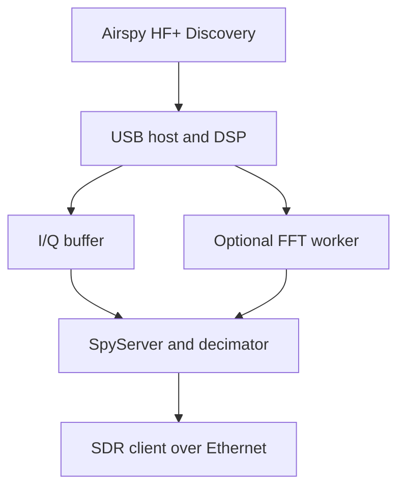

# ESPAirspy

ESPAirspy turns an Airspy HF+ Discovery connected to a M5Stack Unit PoE-P4 into a wired network SDR. A SpyServer-compatible client receives signed 16-bit I/Q over TCP 5555. The web dashboard shows telemetry and provides configuration and firmware updates.

**Status:** pre-1.0 firmware for the U213 ESP32-P4 board and HF+ Discovery. SDROxide 1.7.2 has been exercised on this setup. See the [changelog](CHANGELOG.md) for version history and [hardware validation](docs/validation.md) for historical test results.

## Features

- One SpyServer client at 768, 384, 192, 96, 48, 24 or 12 kS/s.
- Airspy factory oscillator calibration, configurable AGC, attenuation, LNA and AGC threshold.
- Optional on-device spectrum stream and independent software I/Q tuning.
- DHCP or static Ethernet settings, retained in NVS. The default build enables DC correction and leaves the experimental I/Q balancers disabled.
- Web dashboard with device status, history and ESP OTA update. Airspy receiver firmware updates use a separate workflow.

## Architecture



The USB producer is independent of the TCP sender. If the I/Q buffer loses an input block, the firmware disconnects the affected stream so the client can reconnect. See [architecture](docs/architecture.md) and [protocol compatibility](docs/spyserver-protocol.md).

## Download firmware

Open **Releases** on GitHub for versioned OTA and factory images. See [install prebuilt firmware](docs/install.md) for verification and installation, or [CI and releases](docs/releases.md) for test builds and publishing.

## Quick start

1. Connect the antenna to the Airspy, the receiver to the U213 **HOST** USB-C port, and the board to wired Ethernet. Use the separate **PROG/OTG** port for initial flashing. See [hardware and power](docs/hardware.md).
2. In a Bash shell with ESP-IDF v5.5.4 installed, enter the repository and run:

   ```sh
   export IDF_PATH="$HOME/esp/esp-idf-5.5.4"
   . "$IDF_PATH/export.sh"
   ./build.sh
   ./flash.sh /dev/ttyACM0
   ```

   Replace the serial port with your board's port. See the [complete build and flash instructions](docs/build.md) for prerequisites, macOS, Windows and OTA.
3. Find the DHCP address in the serial log or DHCP leases and open `http://<device-ip>/`. On **Overview**, check that **Airspy** is **Connected** and **SpyServer** is **Listening on TCP 5555**. Connect your SpyServer-compatible SDR client to `<device-ip>:5555`.

## Configuration and troubleshooting

See the [web dashboard guide](docs/web-ui.md) for views, themes, diagnostics and refresh behavior.

Use **Settings** to change network, gain and DSP options. **Receiver** shows the applied receiver settings and input telemetry. **Streaming** shows transport and buffer counters. Network changes take effect after a restart. If the Airspy does not enumerate, verify board power, the dedicated host connector and a USB data cable. If the SDR client cannot connect, confirm the IP address, receiver status and that the single client slot is free. For drop counts, clipping, throughput and benchmarks, see [performance](docs/performance.md). ESP and Airspy firmware files are separate. See the [Airspy update instructions](docs/airspy-firmware-update.md).

**Trusted LAN only.** SpyServer, the web dashboard and firmware management use unencrypted, unauthenticated connections. See [SECURITY.md](SECURITY.md) before configuring remote access.

## Development and license

Run `./tests/run-host-tests.sh` on Linux for host regressions and `node tests/web-ui-test.mjs` for the dashboard fixture test. Hardware procedures are in [performance](docs/performance.md). See [contributing](CONTRIBUTING.md), the [project license](LICENSE) and [third-party notices](THIRD_PARTY_NOTICES.md). AI assistance was used during development. The maintainers are responsible for reviewing changes and validating hardware behavior.
