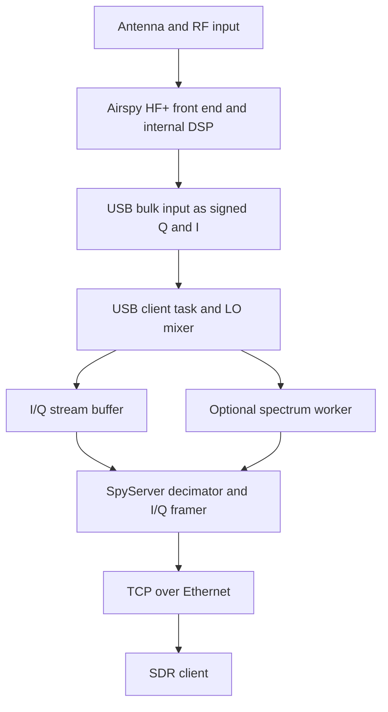
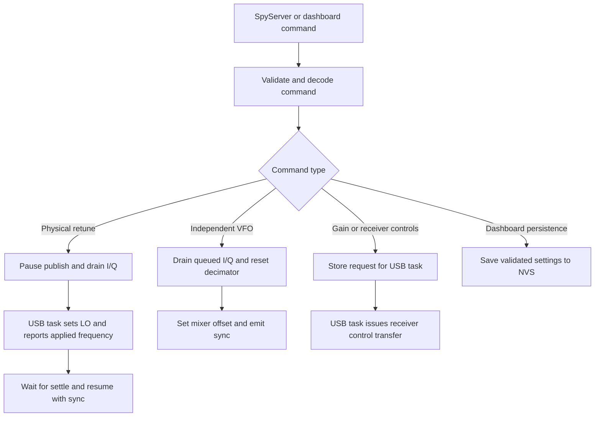

# Firmware architecture

- `main/main.c` initializes NVS, Ethernet and the dashboard, starts the USB host, applies saved receiver options and starts SpyServer. The IP101 example component supplies the board-facing Ethernet integration.
- `main/airspy.c` separates USB host daemon work and the USB client task. On enumeration it claims the receiver interface, selects alternate setting 1, reads rate and calibration information, applies receiver settings and queues four 16 KiB DMA buffers on endpoint 0x81. Each native complex sample has two little-endian 16-bit components in Q,I order.
- The USB completion callback runs in task context. It accounts for input clipping, optionally applies DC correction and I/Q balancing, shifts for LO/factory calibration and outputs I,Q. The spectrum lane copies enabled input to a preallocated pool. The stream lane publishes to a single-producer/single-consumer buffer without waiting. The usual buffer is 512 KiB PSRAM with an internal fallback around 128 KiB. USB DMA and task stacks remain internal.
- SpyServer serves one client and preserves partial command bytes across TCP reads. An optional VFO shift and six cascaded 2× halfband stages produce the selected output rate. The server serializes headers explicitly and completes partial TCP writes. Spectrum has a distinct sequence and worker. A ring overrun closes the session before the server processes a potentially discontinuous read. TCP retransmissions preserve accepted bytes in the session. They cannot restore samples lost upstream.
- USB daemon and client run on core 1, priority 8. The spectrum worker is core 1, priority 4. SpyServer is core 0, priority 5. Network, USB and metrics work share CPU and memory bandwidth. Long socket writes can stall the consumer while acquisition continues.
- Normal settings use NVS. HTTP shows telemetry, updates settings and manages OTA. Fatal USB stream errors or device removal ordinarily restart the ESP. Receiver-update mode has a separate SAM-BA recovery path. No firmware network endpoint is authenticated. See [Security](../SECURITY.md).

## Tuning and receiver settings

The producer handoff allows in-flight callbacks to finish before the physical-retune path drains queued samples. The software VFO runs on the network core and uses the existing capture bandwidth around the hardware center. Retunes and stage changes are intentional stream transitions. Gain commands apply asynchronously. Compare requested and reported settings when measuring the transition. See [SpyServer notes](spyserver-protocol.md) and [Performance](performance.md).
