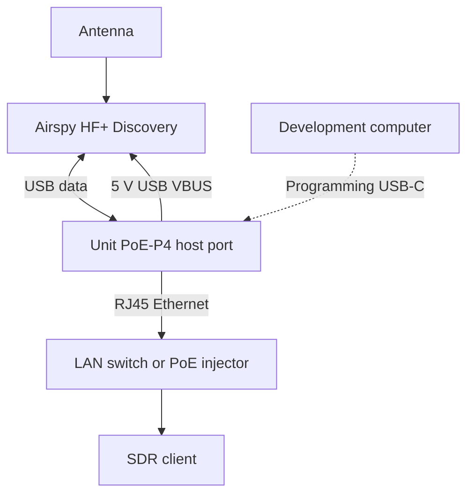

# Hardware setup

| Item | Tested configuration |
|---|---|
| Board | M5Stack Unit PoE-P4, SKU U213. M5Stack specifies the ESP32-P4NRW32 SoC. The tested silicon revision is 1.3. |
| Memory | 16 MiB flash and 32 MiB PSRAM |
| Wired network | On-board IP101 PHY over RMII, 10/100 Mb/s Ethernet. The measured streaming setup used a 100 Mb/s full-duplex link. |
| Receiver | Airspy HF+ Discovery, USB VID:PID `03eb:800c`. A CD unit running R5.0.1-CD was exercised on the board. |
| Host software | SDROxide 1.7.2 exercised in earlier hardware tests. |

Other ESP32-P4 boards, the HF+ Dual Port and other Airspy models are **NOT VERIFIED**. A matching CPU or USB identity alone does not establish board, power, RF or boot compatibility.

1. Connect the antenna to the Airspy. Use a USB data cable between the receiver and the board's dedicated USB-C **HOST** port.
2. Connect the board's RJ45 port to the LAN. DHCP is the default. Read the lease or serial log for the address.
3. Power the board using documented 5 V USB-C input or IEEE 802.3at PoE. M5Stack specifies a 6 W maximum for its PoE output. The receiver draws power from USB VBUS. The board's standalone host-port current limit, worst-case receiver current and simultaneous-source behavior are **NOT VERIFIED**. Follow the board vendor's power instructions.
4. Use the separate **PROG/OTG** USB-C connector for first-time programming and serial logs. If automatic entry into download mode fails, M5Stack documents holding the side button for three seconds until the green LED lights. The board exposes BOOT on GPIO35 and a reset signal on its expansion header. The firmware brings up Ethernet and the USB host at startup. OTA reboots into the selected app slot, with rollback configured in the bootloader.
5. Open the dashboard over HTTP and connect the SDR client to TCP 5555 on the same trusted network. See [Security](../SECURITY.md).

| Ethernet signal | Firmware setting |
|---|---:|
| MDC | GPIO31 |
| MDIO | GPIO52 |
| PHY reset | GPIO51 |
| PHY address | 1 |

The P4 supports High-Speed USB Host and the reference setup enumerated the Airspy at High Speed. The default input needs 3.072 MB/s of payload, above the 12 Mbit/s Full-Speed signaling rate. A charge-only cable, a Full-Speed link or a different board routing can therefore prevent streaming. The default SDK profile does not enable USB hubs. The 400 MHz clock and PSRAM initialization on this pre-v3 board require the SDK patches applied by the build wrapper.

PoE conversion, nearby switching supplies, USB/Ethernet cables and CPU or memory clocks can couple noise into a nearby antenna or feedline. Start with an antenna-versus-termination comparison and change one variable at a time. No source-specific spur measurements are claimed here. See [Performance](performance.md).

- [M5Stack U213 specifications and pin map](https://docs.m5stack.com/en/unit/Unit_PoE-P4)
- [ESP-IDF USB Host guide for ESP32-P4](https://docs.espressif.com/projects/esp-idf/en/v5.5.4/esp32p4/api-reference/peripherals/usb_host.html)
- [Airspy HF+ Discovery](https://airspy.com/airspy-hf-discovery/)
